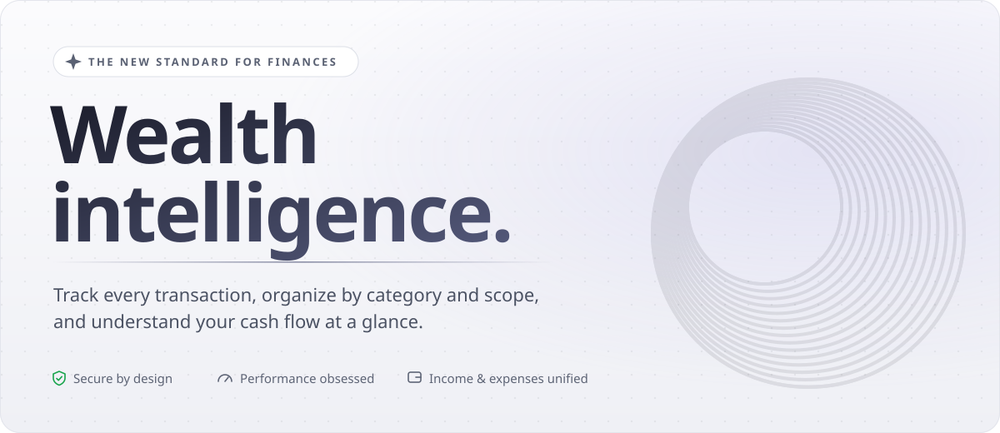

<h1 align="center">João Ferro</h1>

  Builder · Security engineer · Lisbon 🇵🇹 
  I build software where security and performance come first.

  
  
  

---

## 🚀 Building: Wisething

<a href="https://wisething.app">
  <picture>
    <source media="(prefers-color-scheme: dark)" srcset="assets/wisething-banner-dark.svg">
    
  </picture>
</a>

  
  

🟢 Live on Web & Android · iOS coming soon · Built with TypeScript

## 🛠️ Open source: Omega

**Omega** is a family of open-source apps from the team behind Wisething.

- **[Omega Zap](https://github.com/joaomdsferro/omega-zap)**: WhatsApp and Signal in one native desktop client. *Early stage.*

More Omega apps coming soon.

## 💼 Work

**Cyber Analyst & Security Engineer** at **[Worten](https://www.worten.pt)**
